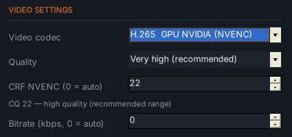
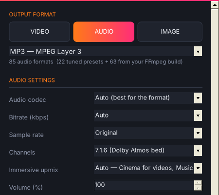
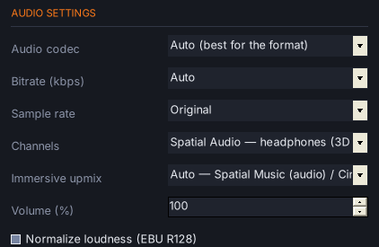
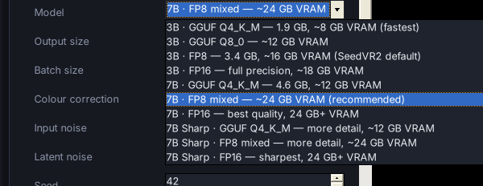

<p align="center">
  
</p>

<h1 align="center">FFmpeg Forge</h1>

<p align="center">
  <b>Convert anything into everything.</b><br>
  A fast, dark-themed Windows converter for video, audio and images, powered by FFmpeg.
</p>

<p align="center">
  
  
  
  
  
</p>

<p align="center">
  
</p>

<p align="center">
  <a href="../../releases/latest"><b>⬇️ Download FFmpeg Forge 1.1.5</b></a> ·
  Portable edition with FFmpeg 9.0.2 included, or the light edition (≈ 0.6 MB) for your own FFmpeg
</p>

---

## 🆕 What's new in 1.1.5

| | |
|---|---|
| 🧹 **Denoiser IA** | One checkbox: SCUNet neural network on your GPU removes noise and film grain cleanly, with Neat Video-style temporal stabilisation. Accelerated with CUDA Graphs and fused attention |
| 👁️ **Live preview** | Before / after comparison window while a video exports (slider or side by side); it closes by itself when the export is finished |
| 💿 **DSD in every layout** | Convert **.dsf / .dff** files to any format and any layout (mono, stereo, 5.1, 7.1, Dolby Atmos / DTS:X beds, Spatial Audio), and export DSD (DSD64 / DSD128) in all those layouts too |
| 🔭 **Upscale VisionNext** | AI upscaling of videos and images with the VisionNext model (VOSR 2.0), **built in — no Visual Enhancer needed**: GPU or CPU, upscale factor **×1 / ×2 / ×3 / ×4 / ×8**, tile size **256 / 512**, videos encoded directly (no picture files) |
| 🎚️ **CRF for NVENC** | Type your own CRF (1–51) for H.264 and H.265 NVIDIA NVENC exports |
| 🌱 **SeedVR2** | AI restoration + upscaling of videos and images (ByteDance-Seed), with a choice of 10 models (3B / 7B / 7B Sharp, FP16 / FP8 / GGUF) and one-click install |
| 🎒 **Portable edition** | One folder with FFmpeg 9.0.2 *full*. Nothing to install, and settings stay in the folder |
| 🧪 **FSR 2 / FSR 3** | Experimental temporal upscaling, with optional frame generation ×2 |
| ✨ **OptiScaler** | Supersampled output scaling with OptiScaler's RCAS and downscalers |
| 🎶 **Spatial Music** | Immersive upmix that recreates the sound of Atmos music mixes, with Spatial Audio for headphones |
| 🎯 **FSR 1 = Lossless Scaling** | Same rendering as Lossless Scaling, plus 10-bit 4:4:4 "screen quality" encoding |

---

## ✨ Features

### 🎞️ Every format your FFmpeg supports
- **Video, audio and image output.** Tuned presets come first, then **every muxer and still-image type found in your `ffmpeg.exe`**. The list is read live from FFmpeg, so a newer build means more formats.
- **Every encoder** of your build is selectable, alongside hand-tuned presets for H.264, H.265, AV1, VP9, VP8 and others.
- **Apple ProRes:** 422 Proxy, 422 LT, 422, 422 HQ, 4444 and 4444 XQ (with alpha).
- **Avid DNxHR:** LB, SQ, HQ, HQX (10-bit) and 444 (10-bit). There is also **FFV1** for lossless archiving.
- **GPU encoders:** NVIDIA NVENC (H.264, H.265, AV1), Intel QuickSync and AMD AMF. H.264 and H.265 NVENC have their own **CRF** field (see below).
- **Formats with strict rules are fixed automatically** (frame size, frame rate, sample rate, channels). This covers DV, GXF, MXF D-10, H.261, AMV, GSM, AMR, DTS and more.

### 🎚️ CRF for NVIDIA NVENC (H.264 & H.265)
<p align="center"></p>

- Choose **H.264 GPU NVIDIA (NVENC)** or **H.265 GPU NVIDIA (NVENC)** as the video codec: a **CRF NVENC** field appears in Video settings.
- Type any value from **1** (best quality, biggest file) to **51** (smallest file), like the CRF of x264 / x265. Good values: **18–23** for H.264, **20–26** for H.265. **0** = automatic (from *Quality*).
- A hint under the field explains the chosen value. FFmpeg Forge uses NVENC constant quality (`-rc vbr -cq N -b:v 0`), so the file size follows the picture like a real CRF.
- It is used everywhere FFmpeg Forge encodes with NVENC: normal conversions, Scale, SeedVR2 and Upscale VisionNext. A bitrate above 0 takes priority.

### 👁️ Live before / after preview
<p align="center"></p>

- While a **video** exports, a preview window shows the **original** frame and the **final** rendered frame (Scale, FSR, OptiScaler, Denoiser, filters, RTX, SeedVR2, VisionNext…).
- **Slider** mode: drag the line (or use ← →) to wipe between the two pictures. **Side by side** mode: both pictures next to each other (Space switches).
- It closes automatically when the export is finished.
- It updates about once per second of video. FFmpeg Forge adds two small JPEG outputs to the same FFmpeg command, so the video is decoded only once and the export is barely slower.
- Tick or untick it in Video settings: **Live before / after preview while exporting**. If a file cannot be previewed, it is converted normally without the preview.
- The preview can never break an export: if its pictures cannot be written (TEMP folder cleaned by Windows or an antivirus, file locked…), only the preview stops and the export goes on.

### 📐 Resolution without limits
- Presets range from 8K UHD, DCI 4K, 4K and 1080p to vertical 9:16 (Reels/Shorts/TikTok), square, 4:5 and cinema 2.39:1.
- You can also type **any width × height**. Use `0` for automatic to keep the aspect ratio.
- **Aspect handling:** *Stretch*, *Fit* (black bars) or *Fill* (crop).

### 🔊 Immersive audio: Dolby Atmos & DTS:X layouts
- **Channel layouts** from mono to 7.1, plus the immersive beds 5.1.2, 5.1.4, 7.1.2, 7.1.4 (Dolby Atmos / DTS:X), **7.1.6** and **9.1.6** (Dolby Atmos), 9.1.4 (DTS:X Pro) and 22.2.
- Up to 24 discrete channels in PCM 24-bit (WAV, W64, CAF, MOV, MKV), Opus, Vorbis, WavPack or TTA.
- **Automatic immersive upmix** turns a stereo track into a real multichannel mix. Choose Auto, **Spatial Music**, Music (classic), Cinema or Live concert:
  - the lead vocal or dialogue is steered to the **center speaker**;
  - instruments keep their place across front, wides and sides;
  - bass and kick drum go to the **LFE**;
  - reverb, room, cymbals and air fill the **wides and height speakers**, and the voice never goes up.

  <p align="center"></p>

- **Spatial Music** is the default for audio. It recreates the sound of the Dolby Atmos music mixes on Apple Music:
  - the lead vocal stays dry in the center;
  - instruments open up to the sides and wides;
  - cymbals and air go overhead;
  - every surround and height speaker plays its own decorrelated reverb, with a vocal "plate" above you.
- **🎧 Spatial Audio for headphones:** pick it in *Channels* to render the 7.1.4 mix in 3D for any headphones. It uses measured HRTFs and a virtual listening room, and writes a normal stereo MP3 / AAC / FLAC file. A multichannel file played on headphones is only folded down to stereo, so choose this option for headphones.

  <p align="center"></p>

- **Atmos / DTS:X passthrough** copies an existing TrueHD Atmos, E-AC-3 JOC or DTS:X track bit-for-bit.
- FFmpeg cannot encode Atmos objects or DTS:X metadata, so new mixes are written as channel-based beds.

### 💿 DSD: .dsf and .dff in every channel layout
<p align="center"></p>

- New audio formats **DSF — DSD Stream File (Sony)** and **DFF — DSDIFF (Philips)**, and new audio codecs **DSD64 2.8 MHz** and **DSD128 5.6 MHz** for each.
- FFmpeg can read DSD but cannot write it, so FFmpeg Forge does it itself: FFmpeg prepares the audio (trim, channels, volume, filters, oversampling to 2.8224 / 5.6448 MHz), then FFmpeg Forge's **1-bit 7th-order delta-sigma modulator** writes the DSD stream.
- In-band noise and distortion (20 Hz–20 kHz, THD+N) measured at about **−113 dB** for DSD64 and **−124 dB** for DSD128.
- **Every channel layout** of the *Channels* list: mono, stereo, 2.1, quad, 5.0, **5.1**, 6.1, **7.1**, the **Dolby Atmos / DTS:X beds** (5.1.2, 5.1.4, 7.1.2, **7.1.4**, 7.1.6, 9.1.4, **9.1.6**), 22.2 and **Spatial Audio for headphones**, with the immersive upmix (Spatial Music, Cinema…) when the source has fewer channels.
  - **DSF** (Sony) holds up to 5.1 by its specification: for bigger layouts FFmpeg Forge automatically writes a **.dff** (DSDIFF), which holds any number of channels (standard channel IDs, `Cnnn` for the others).
  - 0 dBFS is written at 50 % modulation, the SACD reference level.
- **Converting DSD files:** add `.dsf` / `.dff` files like any other audio and convert them to FLAC, WAV, ALAC, MP3, AC3, E-AC3, Opus, MKA, video soundtracks… in any layout, Atmos / DTS:X beds and Spatial Audio included.
  - FFmpeg Forge brings the DSD stream to PCM (**176.4 kHz** for lossless / PCM outputs, **48 kHz** for lossy ones, or the rate you choose), removes the ultrasonic DSD noise and restores the level (+6 dB, peaks limited), so the PCM file has the same loudness as the original master.
  - The codec limits still apply (for example FLAC up to 8 channels, E-AC3 up to 5.1): choose WAV, W64, CAF, MKA or Opus for 7.1.4 and above.

### 🔎 Scale: game-style upscalers for video
<p align="center"></p>

- Tick **Scale** and choose an upscaler:
  - game upscalers: **AMD FSR 1** (EASU + RCAS), **NVIDIA Image Scaling (NIS)**, **Snapdragon GSR**;
  - temporal (experimental): **FSR 2** and **FSR 3** (+ frame generation ×2), with the motion estimated from the video, since a video file has no game motion vectors;
  - for anime: **Anime4K**;
  - for pixel art: **xBR**, **hqx**, **Integer**, **Nearest neighbor**, **Sharp bilinear**;
  - general purpose: **BCAS** (bicubic + CAS), **EWA Lanczos Sharp**, **Lanczos**, **Bicubic**, **Spline**.
- **Sharpness** defaults to 100 %, and **Optimized** (GPU through FFmpeg libplacebo / Vulkan) is ticked by default. Choose a ×1.5–×4 factor or scale to your target resolution.
- **Screen quality encode** and **Full chroma 4:4:4** are ticked by default, so the file keeps what the upscaler draws: 10-bit H.265 / AV1 / VP9, a CRF 4 steps finer, edge-preserving encoder tuning, and full colour resolution for H.265 / VP9, as on screen. Untick 4:4:4 for TVs and phones that cannot play it.
- The FSR, NIS and SGSR shaders are FFmpeg Forge ports of the official open-source SDKs (AMD MIT, NVIDIA MIT, Qualcomm BSD-3). They are embedded in the .exe, and their licenses are in `SHADER_LICENSES.txt`.

### 🧹 Denoiser IA: AI noise and grain removal
<p align="center"></p>
<p align="center"></p>

- **One checkbox.** Tick **Denoiser IA** and FFmpeg Forge removes noise and film grain from videos and images, with a clean, natural result in the spirit of Neat Video.
- **The AI:** [SCUNet](https://github.com/cszn/SCUNet) (Swin-Conv-UNet, Kai Zhang et al., Apache-2.0), trained for real-world noise (camera sensor noise, film grain, compression noise). It runs on your NVIDIA GPU (CUDA) through PyTorch, in tiles, so 4K works too.
- **Fast:**
  - **CUDA Graph:** SCUNet launches about 8,500 small GPU operations per pass; FFmpeg Forge captures the whole network once and replays it in a single call per batch, so Windows no longer spends its time launching kernels one by one;
  - **fused window attention** (one `scaled_dot_product_attention` call instead of einsum + bias + mask + softmax + einsum, same result);
  - whole frames per pass when the GPU memory allows it (up to 8 frames at once for smaller videos), fp16 + cuDNN autotuning, decoding / AI / encoding running in parallel, and a lossless UT Video intermediate (about 10× faster than FFV1);
  - if the GPU memory is full, the work size shrinks automatically. If CUDA Graphs are not available, the normal mode is used.
- **No flicker:** a Neat Video-style temporal stabilisation blends each frame with the previous result in still areas and keeps moving areas sharp.
- **First use:** FFmpeg Forge offers to install the AI (Python 3.12, PyTorch CUDA ≈ 3 GB, SCUNet model 72 MB) in a console window. Until it is installed, the classic FFmpeg denoiser (auto noise profile + temporal FFT) is used.
- It runs **first**, before Scale, OptiScaler, RTX, SeedVR2 and VisionNext, and keeps the original audio, trim and every export setting. The live preview shows the original and the denoised picture.

### ✨ OptiScaler: supersampled upscaling
<p align="center"></p>

- Tick **OptiScaler** for videos and images. It works on top of the **Scale** type, or with EWA Lanczos Sharp when Scale is off.
- It works like OptiScaler's **Output Scaling**:
  1. The upscaler renders at output × **1.25–3** (×1.5 by default).
  2. OptiScaler's **RCAS** sharpens that picture (40 % by default, with optional contrast adaptation).
  3. A downscaler brings it to the output size: **Bicubic**, **Catmull-Rom**, **Lanczos 2** (default), **Lanczos 3**, **Kaiser 2**, **Kaiser 3** or **Magic Kernel**.
- The result has finer edges, less aliasing and less ringing.
- It runs on the GPU through libplacebo / Vulkan.
- These shaders are a GLSL port of [OptiScaler](https://github.com/optiscaler/OptiScaler)'s open-source shaders and are licensed under **GPL-3.0**.
- OptiScaler's DLSS, XeSS, FSR 2+ and MAS need a game's motion vectors and depth buffer, so they cannot run on video files.

### 🟩 NVIDIA RTX AI: tick what you want
<p align="center">
  
</p>

- **RTX Video Super Resolution** (AI upscaling and artifact clean-up) with quality 1–4 and an upscale factor of ×2, ×3 or ×4.
- **RTX TrueHDR** (SDR → HDR10) with contrast, saturation, middle gray and peak brightness (nits). The output is encoded as HDR10 with 10-bit color.
- **DLSS Super Resolution** (NVIDIA NGX AI) with five modes: DLAA, Quality, Balanced, Performance and Ultra Performance.
- **Three engines are supported:**
  - **NVIDIA driver (built-in, default):** `ForgeRTX.exe` uses the RTX Video feature of your NVIDIA driver through the D3D11 video processor, the same way Chrome, VLC and mpv do. No SDK or extra download is needed. Enable *RTX Video Enhancement* in the NVIDIA App;
  - an FFmpeg build that includes NVIDIA's RTX Video filters (`vsr_cuda`, `truehdr_cuda`, `isr_cuda`, `dlpp_drv_cuda`). All their real options open in the visual editor;
  - **[RTXVideoProcessor](https://github.com/DrC0ns0le/RTXVideoProcessor)**, which is built on the official NVIDIA RTX Video SDK and handles VSR ×2 and TrueHDR.
- Requires an NVIDIA RTX GPU and a recent driver. Each engine has its own GPU requirements.

### 🌱 SeedVR2: AI restoration and upscaling (videos & images)
<p align="center"></p>

- **[SeedVR2](https://github.com/ByteDance-Seed/SeedVR)** (ByteDance-Seed, Apache-2.0) is a one-step diffusion model that removes blur, noise and compression artefacts and rebuilds fine detail, with temporal consistency on videos.
- **Choose the model:**

  <p align="center"></p>

  | Model | VRAM | Notes |
  |---|---|---|
  | 3B GGUF Q4_K_M / Q8_0 | ~8 / ~12 GB | fastest, lightest |
  | 3B FP8 / FP16 | ~16 / ~18 GB | SeedVR2 default / full precision |
  | 7B GGUF Q4_K_M | ~12 GB | 7B quality on 12 GB cards |
  | 7B FP8 mixed / FP16 | ~24 GB / 24 GB+ | recommended / best quality |
  | 7B Sharp (Q4_K_M, FP8 mixed, FP16) | 12–24 GB+ | more fine detail |

- **Settings:** output size (×1.5 to ×4, 720p to 4K, or restore only), batch size, colour correction (LAB, wavelet, HSV, AdaIN…), input / latent noise, seed, chunking with temporal overlap, BlockSwap, VAE tiling, RAM offload, attention backend (SDPA, Flash Attention, SageAttention) and torch.compile.
- **Install SeedVR2…** downloads the official command line ([numz/ComfyUI-SeedVR2_VideoUpscaler](https://github.com/numz/ComfyUI-SeedVR2_VideoUpscaler)), Python 3.12 (uv) and PyTorch CUDA 12.8. You can also point to an existing install, ComfyUI included. Models download on first use.
- Your format, codec, audio, trim, Denoiser and filters are kept: FFmpeg prepares the source, SeedVR2 restores it and FFmpeg encodes the final file.
- Needs an NVIDIA GPU (CUDA). It is slow: a 7B model takes minutes per minute of video.

### 🔭 Upscale VisionNext: AI upscaling (videos & images)
<p align="center"></p>

- Tick **Upscale VisionNext** to upscale with the **VisionNext** model. VisionNext's model is **[VOSR 2.0](https://github.com/cswry/VOSR)** (a one-step 1.4B generative super-resolution model, CVPR 2026, Apache-2.0).
- **Two engines:**
  - **Built-in (default) — no Visual Enhancer needed.** Click **Install VisionNext model…** once: FFmpeg Forge installs the official VOSR code, the VOSR 2.0 weights (with their Qwen-Image 2D VAE and DINOv2-L encoder, from Hugging Face `CSWRY/VOSR`), Python 3.12 and PyTorch CUDA **in its own folder** (`VisionNext\` next to `FFmpegForge.exe`) and runs the model itself on your NVIDIA GPU.
  - **Visual Enhancer** — uses your own Visual Enhancer installation (`VE_CLI.exe`, DirectML) and its VisionNext model, if you already have it.
- **Processor:** tick **GPU** (NVIDIA CUDA, fast) or **CPU** (works without an NVIDIA card, but much slower). The choice is shown as soon as Upscale VisionNext is ticked; CPU always uses the built-in engine.
- **Options:**
  - **Model:** VisionNext;
  - **Upscale factor:** ×1 (same size, AI clean-up), ×2, ×3, ×4 or ×8. The work grows with the output size: ×3 ≈ 2×, ×4 ≈ 4× and ×8 ≈ 16× the time of ×2. Very large outputs switch the VAE to tiles automatically;
  - **Tile size:** 256 (less VRAM) or 512 (better quality, VisionNext's default).
- **Videos are encoded directly**, never picture by picture:
  - **Built-in engine:** decoder → VisionNext → final encoder, streamed, with no picture files on disk and one single encode;
  - **Visual Enhancer engine:** its command line only reads pictures, so FFmpeg Forge feeds it small batches of frames while the final encoder is already running: one single encode and no full frame sequence on disk.
- **Speed (built-in engine):** bf16 on the GPU's tensor cores with flash attention, all the tiles of a frame batched in one pass, and the same noise for every frame (no flicker between frames). Norms, tile blending and the colour fix stay in full precision. `torch.compile` / Triton is not needed (Triton does not exist on Windows).
- ×3, ×4 and ×8 need the built-in engine (Visual Enhancer only does ×1 / ×2). H.264 NVENC is limited to 4096 px and H.265 NVENC to 8192 px: for bigger outputs choose libx264 / libx265.
- Your format, codec, audio, trim, rotation, Denoiser and filters are kept. Scale / OptiScaler, SeedVR2 and the RTX options must be off.
- Built-in engine: an NVIDIA GPU (CUDA), 24 GB of VRAM recommended, and about 10 GB of disk space. Visual Enhancer engine: a DirectX 12 GPU.

### 🎛️ Every FFmpeg filter, with a visual editor
<p align="center">
  
</p>

- The **filter library** lists every filter of your build (500+ in a full build). You can search and sort by category: Video, Audio, Multi-input, Source, Sink and Timeline.
- The **parameter editor is generated automatically** for each filter. It shows defaults and ranges, with drop-downs for choices, a color picker, a file picker and help on hover.
- **Timeline support** lets you apply a filter only between two timestamps.
- **45+ one-click presets** include black & white, sepia, cinematic look, sharpen, denoise, deinterlace, stabilize, crop 16:9 / 1:1 / 9:16, speed ×2, slow motion, text watermark, bass boost, noise removal, karaoke, 8D audio and pitch shift.
- **Filter chains** let you enable or disable each filter, reorder them, and edit by double-click.
- An **advanced `-filter_complex` box with extra inputs** handles multi-input filters such as watermark overlay, `amix`, `hstack` and `concat`.

### ⚡ Workflow
- Drag & drop files or **whole folders**. Batch conversion shows per-file and overall progress.
- **Cross-media conversions:**
  - video → image (one frame, every frame, or one every N seconds);
  - image → video;
  - audio → waveform video;
  - audio → waveform picture.
- **Trim** (start / end), rotation and mirroring, frame rate, bitrate, quality and encoding speed.
- Audio volume, **EBU R128 loudness normalization**, sample rate and channels.
- **Originals are never overwritten.** If a name is taken, the new file gets a suffix: `name (2).mp4`.
- **Show command** prints the exact FFmpeg command line and copies it to the clipboard.
- Plain-English error hints, a color log, and settings remembered between sessions.

---

## 📦 Installation

### 🎒 Portable edition (recommended)
1. Download **`FFmpegForge-1.1.5-Portable.rar`** from the [Releases](../../releases) page.
2. Extract it anywhere: a USB stick, `D:\Tools\` or another PC.
3. Double-click **`FFmpegForge.exe`**.

The archive already contains **FFmpeg 9.0.2 *full* (gyan.dev)**: `ffmpeg.exe`, `ffprobe.exe` and `ffplay.exe`. Nothing is installed, and nothing is written to the registry or `%APPDATA%`, because settings are kept in `Settings\`.

```
FFmpegForge-1.1.5-Portable\
├─ FFmpegForge.exe        FFmpeg Forge 1.1.5
├─ ForgeRTX.exe           NVIDIA RTX Video helper
├─ bin\                   ffmpeg.exe · ffprobe.exe · ffplay.exe (9.0.2 full)
├─ FFmpeg\                FFmpeg licence, build info, HTML docs, presets
├─ Settings\              created on first start
├─ Source\                FFmpeg Forge source code + build.bat
├─ portable.txt           portable mode switch (delete it to use %APPDATA%)
└─ README-PORTABLE.txt
```

### 🪶 Light edition (your own FFmpeg)
1. Download FFmpeg for Windows. A *full* build from [gyan.dev](https://www.gyan.dev/ffmpeg/builds/) or [BtbN](https://github.com/BtbN/FFmpeg-Builds/releases) gives the most formats, encoders and filters.
2. Extract it so that `ffmpeg.exe` and `ffprobe.exe` are in **`C:\FFmpeg\bin\`**.
3. Download **`FFmpegForge-1.1.5.rar`** from the [Releases](../../releases) page and extract its content into `C:\FFmpeg\`.
4. Double-click **`FFmpegForge.exe`**.

> FFmpeg Forge looks for FFmpeg in this order:
> 1. next to the `.exe`;
> 2. in `bin\` next to the `.exe` (in portable mode, `bin\` always comes first);
> 3. in `C:\FFmpeg\bin\`;
> 4. in your `PATH`.
>
> You can also pick it manually with **“FFmpeg location…”**.

> Windows SmartScreen may warn you because the executable is not signed. Click **More info → Run anyway**.

**Requirements:**
- Windows 10 or 11 (.NET Framework 4.x is included).
- FFmpeg 5.0 or newer for the light edition.
- A Vulkan graphics driver for the GPU features (Scale, OptiScaler, FSR 2/3).
- An NVIDIA RTX GPU for RTX AI, an NVIDIA GPU with NVENC for the NVENC encoders, an NVIDIA CUDA GPU for SeedVR2, the Denoiser IA and Upscale VisionNext (built in, 24 GB of VRAM recommended; Visual Enhancer is optional).

---

## 🛠️ Build from source

You don't need Visual Studio: Windows already includes the C# compiler.

```bat
cd FFmpegForge
build.bat
```

Or by hand:

`build.bat` compiles `src\*.cs` with the C# compiler included in Windows. It also embeds the shaders (`shaders\*.glsl`) and the HRTF data (`src\hrir_ircam.bin`) as resources.

| File | Role |
|---|---|
| `src/MainForm.cs` | Main window and conversion queue |
| `src/Engine.cs` | FFmpeg command builder, runner, progress parsing, format rules |
| `src/Catalog.cs` | Reads every muxer and encoder from `ffmpeg.exe` (cached) |
| `src/Filters.cs` | Filter library, parameter editor, presets |
| `src/Formats.cs` | Tuned format and codec presets |
| `src/Controls.cs` | Dark theme and custom controls |
| `src/Scaling.cs` | Scale, FSR 2/3, OptiScaler, screen-quality encoding |
| `src/AiDenoise.cs` · `aidenoise/` | Denoiser IA: SCUNet helper, installer and pipeline |
| `src/Denoise.cs` | Classic denoiser (fallback): noise profile and filter chain |
| `src/Spatial.cs` | Spatial Music reverbs and binaural (HRTF) rendering |
| `src/Rtx.cs` · `rtxhelper/ForgeRTX.c` | NVIDIA RTX AI engines |
| `src/SeedVR2.cs` | SeedVR2 installer, models, pipeline and progress |
| `src/Preview.cs` | Live before / after preview window |
| `src/Dsd.cs` | DSD modulator and DSF / DFF writers |
| `src/VisionNext.cs` · `aidenoise/forge_visionnext.py` | Upscale VisionNext: built-in VOSR 2.0 streaming helper and installer, or Visual Enhancer's `VE_CLI.exe` |
| `shaders/` | FSR 1, FSR 2/3, NIS, SGSR, Anime4K and OptiScaler GLSL shaders |

---

## 🙏 Credits

- **[FFmpeg](https://ffmpeg.org)** does all the work behind the scenes. FFmpeg Forge is a graphical front-end that calls `ffmpeg.exe` and `ffprobe.exe`. The portable edition ships the **unmodified FFmpeg 9.0.2 *full* build by [gyan.dev](https://www.gyan.dev/ffmpeg/builds/)** under the GNU GPL v3. Its licence and build information are in `FFmpeg\`, and its source code is at [ffmpeg.org](https://ffmpeg.org/download.html).
- **Shaders and data:**
  - AMD FidelityFX FSR (MIT), NVIDIA Image Scaling (MIT), Snapdragon GSR (BSD-3) and Anime4K (MIT);
  - [OptiScaler](https://github.com/optiscaler/OptiScaler) shaders (GPL-3.0);
  - IRCAM LISTEN HRTF data, as distributed with WebKit;
  - all the details are in `SHADER_LICENSES.txt`.
- **[SCUNet](https://github.com/cszn/SCUNet)** by Kai Zhang et al. (Apache-2.0): the network code ships in `aidenoise/` with its licence; the model and PyTorch are downloaded by the installer.
- **[VOSR](https://github.com/cswry/VOSR)** by Rongyuan Wu, Lingchen Sun et al. (Apache-2.0), the model behind VisionNext: code and weights are downloaded by the installer, not shipped. **Visual Enhancer** by Merserk is used from your own installation when you choose that engine.
- **[SeedVR2](https://github.com/ByteDance-Seed/SeedVR)** by ByteDance-Seed and the **[SeedVR2 command line](https://github.com/numz/ComfyUI-SeedVR2_VideoUpscaler)** by numz / AInVFX (both Apache-2.0) are downloaded by the installer, not shipped.
- FFmpeg is a trademark of Fabrice Bellard, originator of the FFmpeg project. FFmpeg Forge is an independent project, not affiliated with or endorsed by the FFmpeg project.
