<p align="center">
  
</p>

<h1 align="center">FFmpeg Forge 2.0</h1>

<p align="center">
  <b>Convert anything into everything.</b><br>
  A fast, premium Windows converter for video, audio and images, powered by FFmpeg, with built-in AI.
</p>

<p align="center">
  
  
  
  
  
  
</p>

<p align="center">
  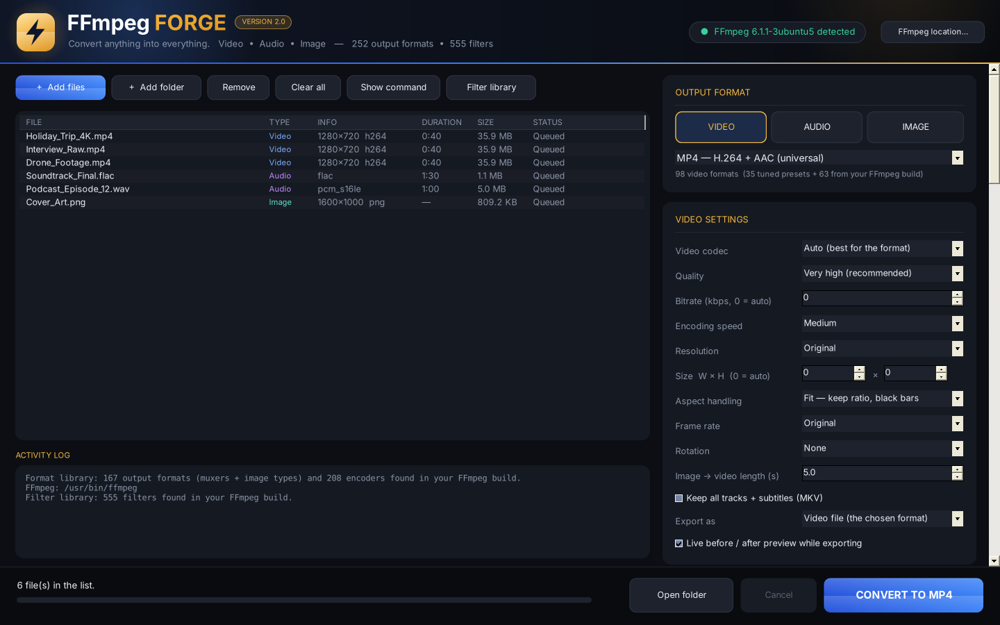
</p>

<p align="center">
  <a href="../../releases/latest"><b>⬇️ Download FFmpeg Forge 2.0.0</b></a> ·
  Portable edition with FFmpeg 9.0.2 included, or the light edition (≈ 0.7 MB) for your own FFmpeg
</p>

---

## 🆕 What's new in 2.0

| | |
|---|---|
| 🎨 **Brand-new design** | Royal blue & gold premium dark theme: gold logo, rounded cards, gradient buttons, blue → gold progress bar. Same familiar layout as 1.1.5: files in the middle, every setting in one column on the right |
| 🧠 **Python / ONNX AI** | Import **your own AI models** — ONNX, PyTorch (`.pth` `.pt` `.ckpt` `.safetensors`) or a Python script — and run them on every frame of your videos and images |
| 🖼️ **Image sequence export** | Export a video as numbered **PNG** (lossless, 16-bit when the render is 10-bit) or **JPEG** pictures, with every video option and AI effect applied |
| 🧹 **Denoiser IA models** | Choose the AI: **SCUNet** (built in), **Nomos8k HAT-L**, **NomosUni DAT** or **PurePhoto SPAN** |
| 🔭 **Faster VisionNext** | Several frames per GPU pass, CPU pre-processing in parallel, colour fix on the GPU — same pixels as before. Upscale factor **×1 / ×2 / ×3 / ×4 / ×8** |
| 🚀 **Faster Denoiser IA** | CUDA Graph replay of the whole network and fused window attention |
| 🛡️ **Safer preview** | The live before / after preview can never make an export fail |

---

## ✨ Features

### 🏠 Drop, choose, convert
<p align="center">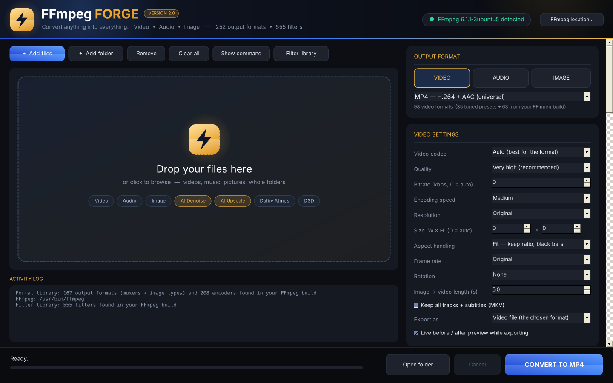</p>

- Drag & drop files or **whole folders**, or click the drop zone to browse. Batch conversion shows per-file and overall progress.
- The **right column** holds every setting, section by section: Output format, Video, Scale, SeedVR2, Upscale VisionNext, Denoiser IA, Python / ONNX AI, OptiScaler, NVIDIA RTX AI, Audio, Image, Filters, Trim and Destination.
- The **footer** is always visible: status, blue → gold progress bar, **Open folder**, **Cancel** and **CONVERT TO …** (or **EXPORT PNG / JPEG FRAMES**).

### 🎞️ Every format your FFmpeg supports
<p align="center">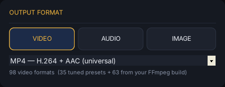</p>

- **Video, audio and image output.** Tuned presets come first, then **every muxer and still-image type found in your `ffmpeg.exe`**, read live from FFmpeg.
- **Every encoder** of your build is selectable, alongside hand-tuned presets for H.264, H.265, AV1, VP9, VP8 and others.
- **Apple ProRes** 422 Proxy / LT / 422 / HQ, 4444 and 4444 XQ (with alpha), **Avid DNxHR** LB / SQ / HQ / HQX / 444, and **FFV1** for lossless archiving.
- **GPU encoders:** NVIDIA NVENC (H.264, H.265, AV1), Intel QuickSync and AMD AMF.
- **Formats with strict rules are fixed automatically** (frame size, frame rate, sample rate, channels): DV, GXF, MXF D-10, H.261, AMV, GSM, AMR, DTS and more.

### 🎬 Video settings, CRF NVENC and image sequences
<p align="center">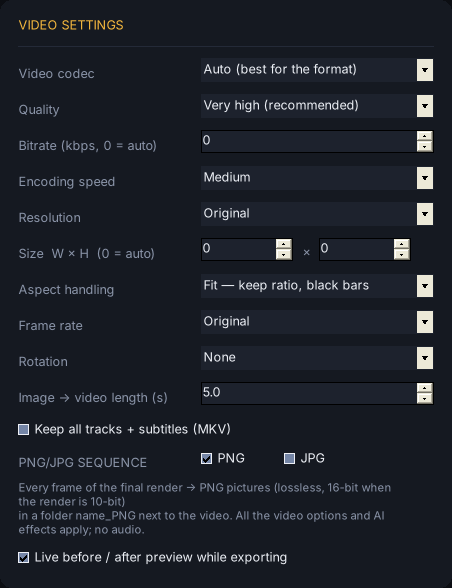</p>

- Codec, quality, bitrate, encoding speed, **resolution without limits** (8K, DCI 4K, 4K, 1080p, vertical 9:16, square, 4:5, cinema 2.39:1 or any width × height), aspect handling (Stretch / Fit / Fill), frame rate and rotation.
- **CRF NVENC:** with H.264 or H.265 NVIDIA NVENC, type any CRF from 1 to 51 (`-rc vbr -cq N -b:v 0`). Good values: 18–23 for H.264, 20–26 for H.265.
- **Export as → Image sequence (PNG or JPEG).** Every frame of the final render is saved as `name_000001.png`, `name_000002.png`… in a `name_PNG` (or `name_JPEG`) folder next to the video.
  - It works with **every video option**: resolution, frame rate, trim, filters, Denoiser IA, Python / ONNX AI, Scale, OptiScaler, NVIDIA RTX, SeedVR2 and Upscale VisionNext.
  - FFmpeg Forge renders a lossless 4:4:4 FFV1 file first, then writes the pictures: **PNG** is lossless (16-bit when the render is 10-bit), **JPEG** uses quality 2 with full 4:4:4 colour.

### 👁️ Live before / after preview
<p align="center">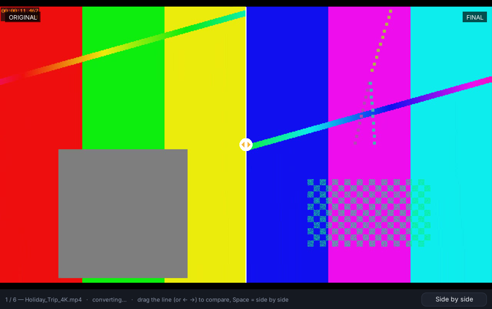</p>

- While a **video** exports, a window shows the **original** and the **final** frame (Scale, FSR, OptiScaler, Denoiser, filters, RTX, SeedVR2, VisionNext…).
- **Slider** mode (drag the line, or ← →) or **side by side** (Space). It closes by itself when the export is finished.
- It updates about once per second of video from the same FFmpeg command, so the export is barely slower — and if a preview picture cannot be written, only the preview stops: **the export always goes on**.

### 🧹 Denoiser IA: AI noise and grain removal
<p align="center">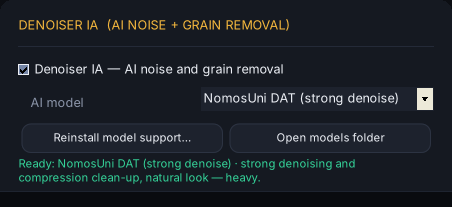</p>
<p align="center">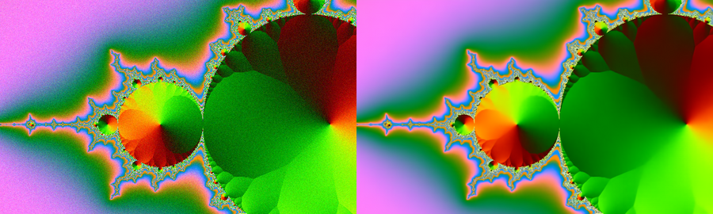</p>

- **One checkbox and a model list:**

  | Model | Best for | Speed |
  |---|---|---|
  | **SCUNet** (built in) | real camera noise, film grain, compression noise — with Neat Video-style temporal stabilisation | fast |
  | **Nomos8k HAT-L** | the finest detail and the strongest restoration (noise, blur, JPEG) | very heavy |
  | **NomosUni DAT** | strong denoising and compression clean-up, natural look | heavy |
  | **PurePhoto SPAN** | light clean-up of good-quality sources | very fast |

- HAT-L, DAT and SPAN are ×4 restoration models: FFmpeg Forge runs them and brings the result back to the source size (antialiased supersampling), so the picture is cleaned **without changing its resolution**.
- **Fast:** CUDA Graph replay of the whole SCUNet network (one call per batch instead of ~8,500 small GPU launches), fused window attention, fp16 / bf16, up to 8 frames per pass, decoding / AI / encoding in parallel, lossless UT Video intermediate. Out-of-memory errors shrink the work size automatically.
- **First use:** FFmpeg Forge installs the AI (Python 3.12, PyTorch CUDA ≈ 3 GB, SCUNet 72 MB, model loader) in a console window. Until then, the classic FFmpeg denoiser is used. The HAT-L / DAT / SPAN files go in `models\` next to `FFmpegForge.exe` (see the *Denoiser-Models* archive).

### 🧠 Python / ONNX AI: run your own models
<p align="center">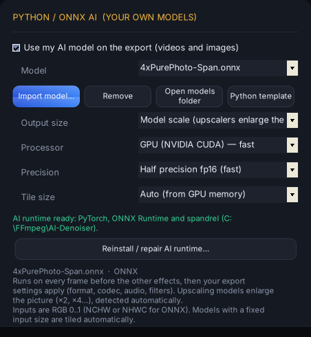</p>

- Tick **Use my AI model**, click **Import model…** and pick a file — it is copied into FFmpeg Forge's `models\custom` library and runs on every frame of your **videos and images**.
- **Supported models:**
  - **ONNX** (`.onnx`) through ONNX Runtime GPU (CUDA) or CPU — NCHW or NHWC, RGB 0..1, fp32 or fp16. Models with a **fixed input size are tiled automatically**; external-data files are imported too.
  - **PyTorch** (`.pth` `.pt` `.ckpt` `.safetensors` `.bin`) loaded by [spandrel](https://github.com/chaiNNer-org/spandrel): ESRGAN, Real-ESRGAN, SwinIR, HAT, DAT, SPAN, SCUNet, NAFNet, Restormer, OmniSR and many more.
  - **Python script** (`.py`): either `load(device)` returning a `torch.nn.Module` (NCHW RGB 0..1, tiled on the GPU for you), or `process(img)` taking and returning an `HxWx3` RGB frame. **Python template** writes a ready-to-edit example.
- The **scale is detected automatically** (×1, ×2, ×4…). Options: model scale or **keep the original size**, GPU or CPU, fp16 or fp32, tile size (auto from GPU memory, 256, 512, 1024, whole frame). Tiles are blended, without seams.
- It runs **before** Scale, RTX, SeedVR2 and VisionNext, and keeps your format, codec, audio, trim and filters.
- **Install AI runtime…** installs PyTorch CUDA, ONNX Runtime GPU and spandrel once.

### 🔭 Upscale VisionNext: AI upscaling (videos & images)
<p align="center">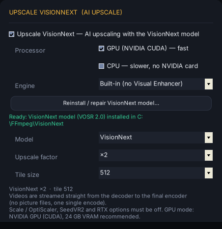</p>

- VisionNext's model is **[VOSR 2.0](https://github.com/cswry/VOSR)** (one-step 1.4B generative super-resolution, CVPR 2026, Apache-2.0).
- **Built-in engine — no Visual Enhancer needed:** click **Install VisionNext model…** once; FFmpeg Forge installs the official VOSR code, the VOSR 2.0 weights (Qwen-Image VAE, DINOv2-L), Python and PyTorch CUDA in its own `VisionNext\` folder. The **Visual Enhancer** engine (`VE_CLI.exe`) is still available.
- **Processor:** GPU (NVIDIA CUDA, fast) or CPU (no NVIDIA card needed, much slower).
- **Upscale factor:** ×1 (same size, AI clean-up), ×2, ×3, ×4 or ×8 (×3, ×4 and ×8 with the built-in engine; very large outputs switch the VAE to tiles automatically). **Tile size:** 256 or 512.
- **Videos are encoded directly**, never picture by picture: decoder → VisionNext → final encoder, streamed, one single encode (with Visual Enhancer, small batches of frames while the encoder runs).
- **Speed:** bf16 + flash attention, all the tiles of a frame in one pass, **2 frames per pass** on 20 GB+ GPUs, CPU pre-resize in parallel and the colour fix on the GPU — with the same pixels as the official inference. Same noise on every frame: no flicker. No Triton / `torch.compile` needed on Windows.
- An NVIDIA GPU with 24 GB of VRAM is recommended. H.264 NVENC is limited to 4096 px and H.265 NVENC to 8192 px: choose libx264 / libx265 beyond.

### 🌱 SeedVR2: AI restoration and upscaling
<p align="center">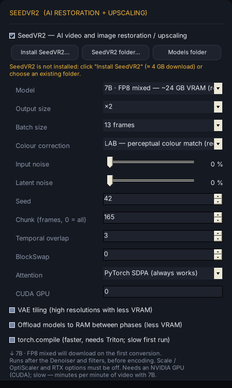</p>

- **[SeedVR2](https://github.com/ByteDance-Seed/SeedVR)** (ByteDance-Seed, Apache-2.0): one-step diffusion restoration with temporal consistency on videos.

  | Model | VRAM | Notes |
  |---|---|---|
  | 3B GGUF Q4_K_M / Q8_0 | ~8 / ~12 GB | fastest, lightest |
  | 3B FP8 / FP16 | ~16 / ~18 GB | default / full precision |
  | 7B GGUF Q4_K_M | ~12 GB | 7B quality on 12 GB cards |
  | 7B FP8 mixed / FP16 | ~24 GB / 24 GB+ | recommended / best quality |
  | 7B Sharp (Q4_K_M, FP8 mixed, FP16) | 12–24 GB+ | more fine detail |

- Output size, batch size, colour correction, input / latent noise, seed, chunking with temporal overlap, BlockSwap, VAE tiling, RAM offload, attention backend and torch.compile. **Install SeedVR2…** sets everything up in one click.

### 🔎 Scale: game-style upscalers for video
<p align="center">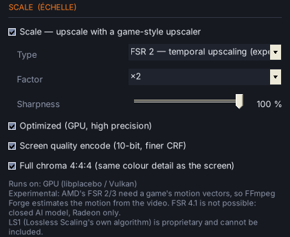</p>

- **AMD FSR 1** (EASU + RCAS), **NVIDIA Image Scaling**, **Snapdragon GSR**, temporal **FSR 2 / FSR 3** (+ frame generation ×2, experimental), **Anime4K**, pixel-art scalers (**xBR**, **hqx**, Integer, Nearest, Sharp bilinear) and **BCAS**, **EWA Lanczos Sharp**, Lanczos, Bicubic, Spline.
- GPU processing through FFmpeg's libplacebo / Vulkan, **screen-quality encode** (10-bit, finer CRF) and **full chroma 4:4:4** by default.

### ✨ OptiScaler: supersampled upscaling
<p align="center">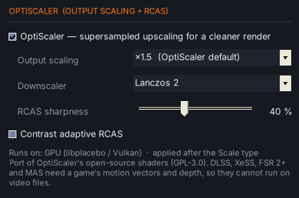</p>

- Like OptiScaler's **Output Scaling**: render at output × 1.25–3, sharpen with **RCAS**, then downscale (Bicubic, Catmull-Rom, Lanczos 2 / 3, Kaiser 2 / 3, Magic Kernel) for finer edges and less aliasing. GLSL port of [OptiScaler](https://github.com/optiscaler/OptiScaler)'s shaders (GPL-3.0).

### 🟩 NVIDIA RTX AI
<p align="center">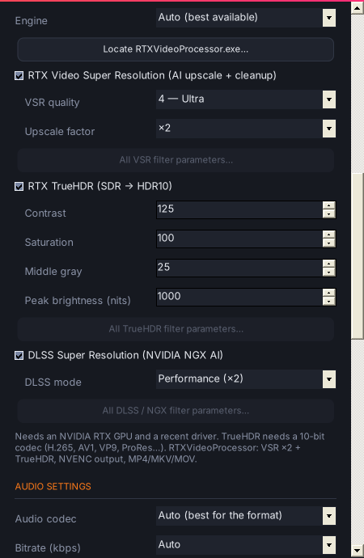</p>

- **RTX Video Super Resolution** (quality 1–4, ×2 / ×3 / ×4), **RTX TrueHDR** (SDR → HDR10) and **DLSS Super Resolution** modes.
- Engines: the NVIDIA driver (built-in `ForgeRTX.exe`, like Chrome / VLC / mpv), an FFmpeg build with NVIDIA's RTX filters, or [RTXVideoProcessor](https://github.com/DrC0ns0le/RTXVideoProcessor).

### 🔊 Audio: Dolby Atmos / DTS:X layouts, Spatial Audio and DSD
<p align="center">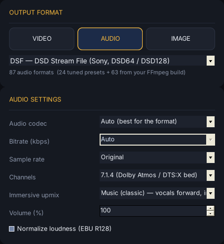</p>

- **Channel layouts** from mono to 7.1, the Dolby Atmos / DTS:X beds 5.1.2, 5.1.4, 7.1.2, **7.1.4**, 7.1.6, 9.1.4, **9.1.6** and 22.2 — up to 24 discrete channels.
- **Immersive upmix** (Auto, **Spatial Music**, Music, Cinema, Live concert): vocals to the center, instruments across the front and sides, bass to the LFE, reverb and air to the wides and heights.
- **🎧 Spatial Audio for headphones:** the 7.1.4 mix rendered in 3D with measured HRTFs, written as a normal stereo file.
- **Atmos / DTS:X passthrough** (TrueHD Atmos, E-AC-3 JOC, DTS:X) bit-for-bit.
- **💿 DSD:** export **.dsf** (Sony) and **.dff** (Philips DSDIFF) in **DSD64 / DSD128**, in every layout, with FFmpeg Forge's own 7th-order delta-sigma modulator (THD+N ≈ −113 dB DSD64, −124 dB DSD128). DSF goes up to 5.1; bigger layouts are written as .dff automatically. DSD sources convert to any format and layout.

### 🖼️ Image output
<p align="center">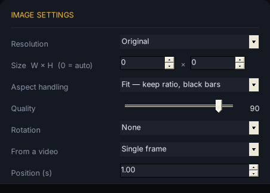</p>

- Resolution, aspect, quality and rotation for pictures; **video → image** as a single frame, every frame, or one every N seconds.

### 🎛️ Every FFmpeg filter, with a visual editor
<p align="center">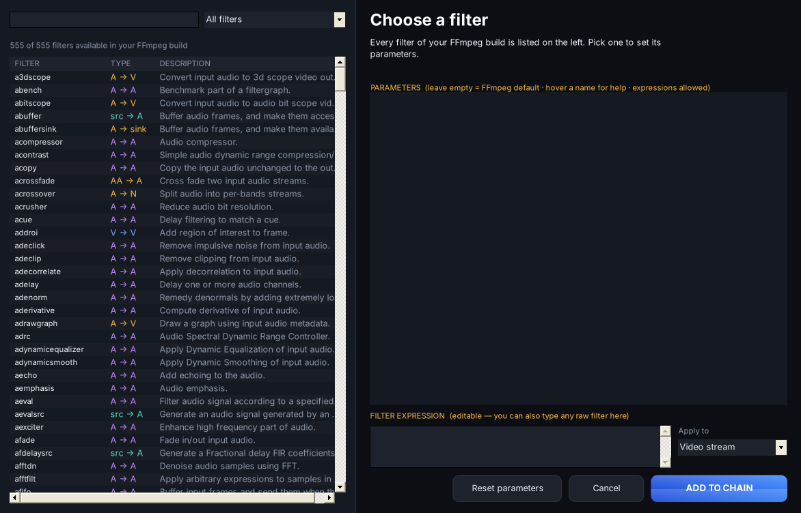</p>
<p align="center">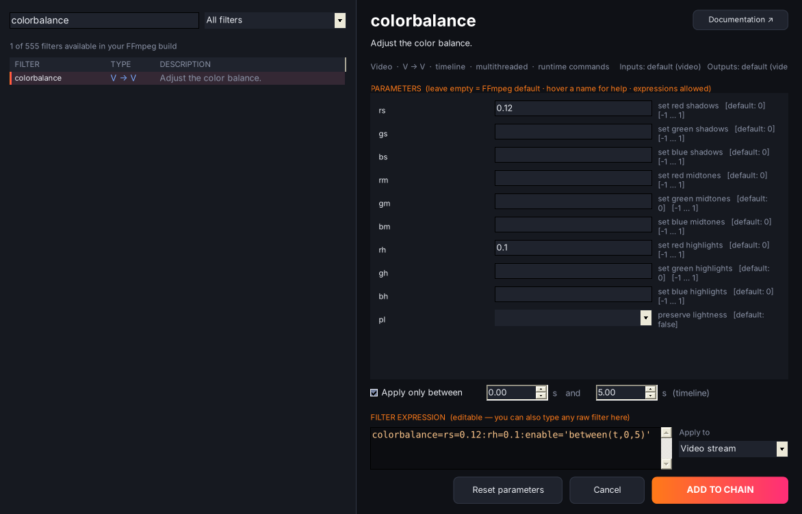</p>

- The **filter library** lists every filter of your build (500+), searchable and sorted by category, with an **automatically generated parameter editor** (defaults, ranges, drop-downs, colour and file pickers, help on hover) and **timeline** support.
- **45+ one-click presets** (black & white, cinematic, sharpen, denoise, deinterlace, stabilize, crops, speed, watermark, bass boost, karaoke, 8D audio, pitch…), **filter chains** you can reorder, and an advanced `-filter_complex` box with extra inputs.

### ⚡ Trim, destination and workflow
<p align="center">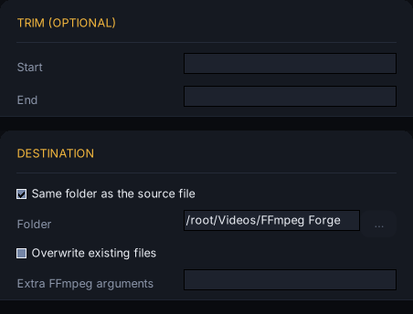</p>

- **Trim** (start / end), output folder or next to the source, overwrite option and **extra FFmpeg arguments**.
- Cross-media conversions: video → image, image → video, audio → waveform video or picture.
- **Originals are never overwritten** (`name (2).mp4`). **Show command** prints and copies the exact FFmpeg command line. Plain-English error hints, colour log, settings remembered.

---

## 📦 Installation

### 🎒 Portable edition (recommended)
1. Download **`FFmpegForge-2.0.0-Portable.rar`** from the [Releases](../../releases) page.
2. Extract it anywhere (USB stick, `D:\Tools\`, another PC).
3. Double-click **`FFmpegForge.exe`**.
4. *(Optional)* extract **`FFmpegForge-2.0.0-Denoiser-Models.rar`** next to it for the HAT-L / DAT / SPAN Denoiser models.

The archive contains **FFmpeg 9.0.2 *full* (gyan.dev)**. Nothing is installed and nothing is written to the registry: settings stay in `Settings\`.

```
FFmpegForge-2.0.0-Portable\
├─ FFmpegForge.exe        FFmpeg Forge 2.0.0
├─ ForgeRTX.exe           NVIDIA RTX Video helper
├─ bin\                   ffmpeg.exe · ffprobe.exe · ffplay.exe (9.0.2 full)
├─ models\                Denoiser IA models + custom\ (your Python / ONNX models)
├─ FFmpeg\                FFmpeg licence, build info, docs, presets
├─ Settings\              created on first start
├─ Source\                FFmpeg Forge source code + build.bat
└─ portable.txt           portable mode switch (delete it to use %APPDATA%)
```

### 🪶 Light edition (your own FFmpeg)
1. Put `ffmpeg.exe` and `ffprobe.exe` (a *full* build from [gyan.dev](https://www.gyan.dev/ffmpeg/builds/) or [BtbN](https://github.com/BtbN/FFmpeg-Builds/releases)) in **`C:\FFmpeg\bin\`**.
2. Extract **`FFmpegForge-2.0.0.rar`** into `C:\FFmpeg\` and run **`FFmpegForge.exe`**.

> FFmpeg Forge looks for FFmpeg next to the `.exe`, then in `bin\`, then in `C:\FFmpeg\bin\`, then in your `PATH` — or choose it with **FFmpeg location…**.

> Windows SmartScreen may warn you because the executable is not signed: **More info → Run anyway**.

**Requirements:** Windows 10 or 11 (.NET Framework 4.x included) · FFmpeg 5.0+ for the light edition · a Vulkan driver for Scale / OptiScaler / FSR 2-3 · an NVIDIA GPU (CUDA) for the AI features (24 GB of VRAM recommended for VisionNext), an RTX GPU for RTX AI.

---

## 🛠️ Build from source

No Visual Studio needed: `build.bat` compiles `src\*.cs` with the C# compiler included in Windows and embeds the shaders, the HRTF data and the Python helpers.

| File | Role |
|---|---|
| `src/MainForm.cs` | Main window, settings column and conversion queue |
| `src/Controls.cs` | 2.0 design: theme, header, cards, buttons, progress bar, drop zone |
| `src/Engine.cs` | FFmpeg command builder, runner, progress, format rules |
| `src/Catalog.cs` · `src/Formats.cs` | Muxers / encoders read from `ffmpeg.exe`, tuned presets |
| `src/Filters.cs` | Filter library, parameter editor, presets |
| `src/Scaling.cs` | Scale, FSR 2/3, OptiScaler, screen-quality encoding |
| `src/AiDenoise.cs` · `aidenoise/forge_ai_denoise.py` | Denoiser IA: SCUNet / HAT-L / DAT / SPAN, installers |
| `src/CustomAi.cs` · `aidenoise/forge_custom_ai.py` | Python / ONNX AI: model library, probe and streaming helper |
| `src/VisionNext.cs` · `aidenoise/forge_visionnext.py` | Upscale VisionNext (built-in VOSR 2.0 or Visual Enhancer) |
| `src/SeedVR2.cs` | SeedVR2 installer, models and pipeline |
| `src/Rtx.cs` · `rtxhelper/ForgeRTX.c` | NVIDIA RTX AI engines and the streaming driver |
| `src/Preview.cs` | Live before / after preview |
| `src/Dsd.cs` | DSD modulator and DSF / DFF writers |
| `src/Spatial.cs` · `src/Denoise.cs` | Spatial Music / HRTF rendering, classic denoiser |
| `shaders/` | FSR 1, FSR 2/3, NIS, SGSR, Anime4K and OptiScaler GLSL shaders |

---

## 🙏 Credits

- **[FFmpeg](https://ffmpeg.org)** does the work behind the scenes. The portable edition ships the **unmodified FFmpeg 9.0.2 *full* build by [gyan.dev](https://www.gyan.dev/ffmpeg/builds/)** (GPL v3); licence and build information are in `FFmpeg\`.
- **Shaders and data:** AMD FidelityFX FSR (MIT), NVIDIA Image Scaling (MIT), Snapdragon GSR (BSD-3), Anime4K (MIT), [OptiScaler](https://github.com/optiscaler/OptiScaler) shaders (GPL-3.0), IRCAM LISTEN HRTF — details in `SHADER_LICENSES.txt`.
- **AI:** [SCUNet](https://github.com/cszn/SCUNet) by Kai Zhang et al. (Apache-2.0) · [VOSR](https://github.com/cswry/VOSR) (Apache-2.0) · [SeedVR2](https://github.com/ByteDance-Seed/SeedVR) and its [command line](https://github.com/numz/ComfyUI-SeedVR2_VideoUpscaler) (Apache-2.0) · [spandrel](https://github.com/chaiNNer-org/spandrel) (MIT) · [ONNX Runtime](https://onnxruntime.ai) (MIT) · PyTorch (BSD). Code and weights are downloaded by the installers, not shipped.
- **Denoiser models:** 4xNomos8kHAT-L_otf and 4xNomosUniDAT_otf by Philip Hofmann (Phhofm), 4xPurePhoto-Span — published on [OpenModelDB](https://openmodeldb.info) under their authors' licences.
- **Visual Enhancer** by Merserk is used from your own installation when you choose that engine.
- FFmpeg is a trademark of Fabrice Bellard. FFmpeg Forge is an independent project, not affiliated with or endorsed by the FFmpeg project.
